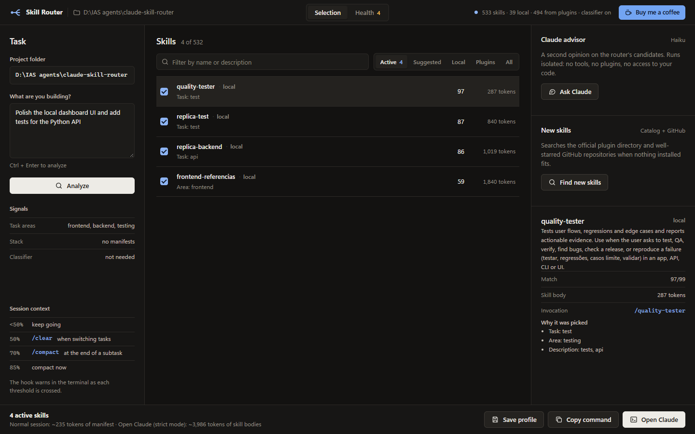

# Claude Skill Router

**Give every Claude Code session only the skills it needs.**

[](https://github.com/rec0des/claude-skill-router/actions/workflows/tests.yml)
[](LICENSE)


[](https://ko-fi.com/D2T128TPPL)



## Why

Skills pile up. A few plugins in, Claude Code is carrying hundreds of them, and every session starts with all of their descriptions in context. On the machine this was built on, 533 installed skills add up to about **45,000 tokens of descriptions**. Claude has to pick from that list on every turn, so the right skill is easy to miss and a generic one often wins.

The router fixes that locally:

- **It picks the skills that fit.** Up to four, ranked from the task you type and the project you are in, each with a stated reason.
- **It cuts context.** In strict mode Claude starts with slash-command skills disabled and only the selected skill bodies loaded (about 4,000 tokens instead of the full list). Per project, it can switch off plugins you never use there.
- **It keeps your skills healthy.** Insecure, obsolete and broken skills are flagged with evidence; insecure ones are never picked.
- **It finds what is missing.** When nothing installed fits, it suggests reviewed plugins and well-maintained GitHub repositories, and installs only after an audit and your click.
- **It tells you when to `/compact`.** Warnings at 50, 70 and 85 percent of the context window.

Everything runs on your machine. No code leaves it unless you press a button that says so.

## Quick start

Requirements: Windows with PowerShell, Python 3.10 or newer, and the Claude Code CLI. No Python packages are needed.

```powershell
git clone https://github.com/rec0des/claude-skill-router.git
cd claude-skill-router
python install_integration.py
```

Open a new terminal and start Claude as usual. The first lines of the session show the router:

```text
◆ Skill Router · my-shop · strict mode
  533 skills indexed (4 command · 35 global · 494 plugin)
  Health: 3 risky, 1 obsolete · /route-skills health
```

Then describe the task. The router injects its pick before Claude answers:

```text
SKILL ROUTER: minimal skill set for this prompt (selected locally, no code sent anywhere).
- stripe:stripe-best-practices: Stripe integration guidance: Checkout, webhooks, ...
- product-builder: Builds complete, usable and verifiable product increments ...
```

Open the panel any time with `skill-router` (or `.\start.ps1`) at `http://127.0.0.1:9127`.

## How you use it

| Where you run Claude | Mode | What the router does |
|---|---|---|
| `claude` in PowerShell | **strict** | Starts Claude with slash-command skills disabled and loads only the selected skill bodies. This is where the token savings are. |
| `claude-raw`, VS Code, desktop app | lazy | Claude still lists every skill; the router adds a short pick (about 250 tokens) so the right one is used. |
| **Open Claude** in the panel | launcher | Opens a terminal with the skills you chose in the panel already loaded. |

Use the `/route-skills` skill inside a session when the task changes, or to run the other tools by name: `/route-skills health`, `/route-skills discover`, `/route-skills plugins`, `/route-skills panel`.

## The panel

- **Selection.** Type the task, review the ranked skills and the reason for each, toggle any of them, see the context cost, then copy the launch command or open Claude.
- **Ask Claude.** A second opinion from Claude Haiku, run isolated with no tools, plugins or session (about 5 seconds and US$0.001). Applying its picks trains the ranking for that project.
- **New skills.** Searches the official plugin directory, your marketplaces and GitHub when nothing installed fits, with a 0 to 100 trust score.
- **Health.** Audit results with file and line evidence, reversible actions, the per-project plugin profile and the router's own accuracy.
- **Update Claude Code.** Appears only when your update channel has a newer release, and runs the official `claude update`.

## Skill health

The audit runs once a day in the background, or on demand (**Audit now**, `app.py health --refresh`). About 20 seconds for 500 skills.

| Status | What triggers it | Effect |
|---|---|---|
| Insecure | prompt injection, credential exfiltration, hidden bidi Unicode, plugin on the official blocklist | never selected |
| Risky | `curl \| sh`, permission bypass flags, destructive commands, encoded execution | warning shown with the pick |
| Obsolete | the skill says it is deprecated, the plugin left its marketplace, the file is unreadable | ranked lower |
| Outdated | the marketplace has a newer plugin version, using Claude Code's own version rule | informational |
| Review | missing frontmatter, empty or placeholder description | informational |

Security-focused skills that quote these patterns as examples are scored as low severity. Actions are reversible: block a skill in the router, move a local skill to quarantine and restore it, or disable, update and uninstall plugins through the official `claude plugin` CLI. Files are only deleted from the quarantine, one confirmed entry at a time.

## Command line

```text
app.py route --project . --task "<task>"      ranked selection, as Markdown
app.py health [--refresh] [--all]             audit report
app.py cleanup [--apply]                      quarantine or block obsolete and insecure skills
app.py discover --task "<task>" [--offline]   find skills you do not have yet
app.py plugin-profile [--apply | --undo]      turn off unused plugins in this project only
app.py claude-version [--refresh]             compare Claude Code with your update channel
app.py claude-update                          run the official claude update
app.py metrics                                selection accuracy, injected tokens, hook latency
app.py status | version
```

## Configuration

An optional `config.json` next to `app.py`:

```json
{
  "max_skills": 4,
  "include_plugins": true,
  "pinned": [],
  "blocked": [],
  "keep_plugins": [],
  "auto_cleanup": false,
  "context_limit": null,
  "laya": false
}
```

Environment variables: `SKILL_ROUTER_MODE` (`strict`, `lazy`, `launcher`) and `SKILL_ROUTER_CONTEXT_LIMIT` (tokens).

### Optional Laya classifier

Laya is a local model that guesses the task's area (frontend, backend, testing and so on) when no keyword in the prompt does. It is off by default because it holds about 900 MB of RAM and seldom changes the selection.

To use it, set `"laya": true` and put a service at `../laya-runtime/laya_service.py`, or point `SKILL_ROUTER_LAYA_DIR` at another folder. The service runs from that folder's `.venv` and answers on `127.0.0.1:9130`. The first session hook starts it, and a start marker keeps sessions that open together from starting a second copy.

If the service uses Python's `http.server`, set `allow_reuse_address = False`, set `SO_EXCLUSIVEADDRUSE` on Windows, and bind the port before loading the model. A duplicate then fails at once instead of loading the model and sharing the port.

## Privacy and security

- Analysis is local: file names and the first 6,000 characters of known manifests, up to 1,200 files, skipping dependency and build folders.
- Data leaves the machine only when you ask: **Ask Claude** sends the task and the candidate skill names and descriptions, never your code; **New skills** queries GitHub through `gh`. The daily Claude Code version check reads public release tags from the npm registry and sends nothing about you.
- The panel listens on `127.0.0.1` only and rejects requests from other origins, other hosts and pages without its own header.
- Skill code is never executed during analysis, audits or discovery.

## Uninstall

1. In `~/.claude/settings.json`, remove the hook entries that mention `claude-skill-router`.
2. Delete the blocks between the `CLAUDE SKILL ROUTER` markers in `~/.claude/CLAUDE.md`, `~/.codex/AGENTS.md` and your PowerShell profile.
3. Delete `~/.claude/skills/route-skills`.

`install_integration.py` backs up `settings.json` before changing it, so you can also restore that backup.

## Development

```powershell
python -m unittest discover -s tests
```

Changes are listed in [CHANGELOG.md](CHANGELOG.md). Issues and pull requests are welcome: see [CONTRIBUTING.md](CONTRIBUTING.md), and report vulnerabilities privately as described in [SECURITY.md](SECURITY.md).

## Support

If the router saves you tokens, you can [buy me a coffee](https://ko-fi.com/D2T128TPPL).

## License

[MIT](LICENSE)
